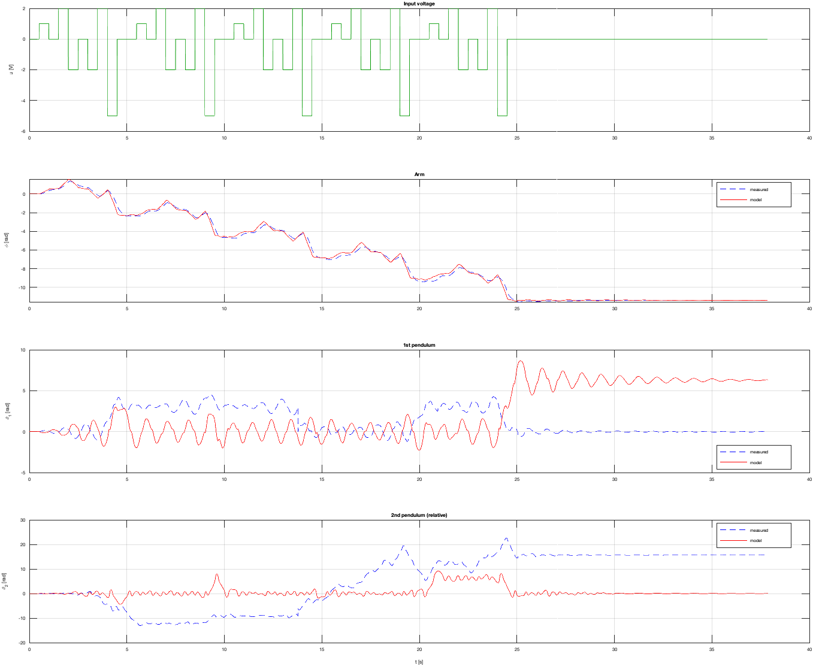
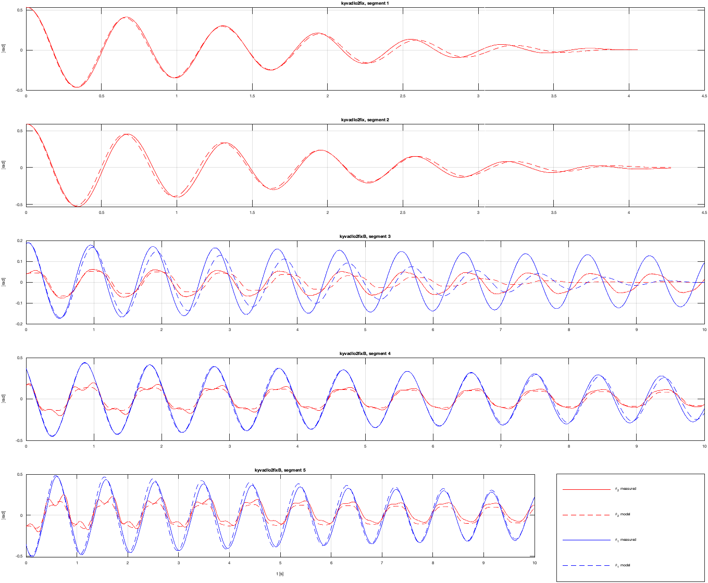

# Rotary Double Pendulum – Modelling, Identification and Validation

Nonlinear dynamic model of a **rotary (Furuta-type) double pendulum** driven by a
DC motor, derived from first principles in MATLAB, with physical parameters
identified from measurements on a real laboratory rig and validated against them.

Semester project for *Modelling and Simulation of Dynamic Systems* (MSD),
Czech Technical University in Prague.



## The system

A horizontal arm is rotated by a geared DC motor (PWM-driven); a two-link
pendulum hangs from the end of the arm and swings in the plane tangential to the
arm's motion. Three degrees of freedom, one actuator:

| coordinate | meaning |
|---|---|
| φ | rotation of the arm (motor axis, vertical) |
| θ₁ | 1st pendulum, measured from the downward vertical |
| θ₂ | 2nd pendulum, relative to the 1st one |

Measured signals (sampled at 200 Hz): control voltage and three quadrature
encoders (500 PPR on the motor, 1024 PPR on each pendulum joint).

## What was done

1. **Derivation of the equations of motion** – Denavit–Hartenberg kinematics,
   geometric Jacobians, kinetic/potential energy, Lagrange equations of the 2nd kind
   with the Coriolis matrix built from Christoffel symbols
   ([`derivation/derive_equations.m`](derivation/derive_equations.m), Symbolic Math Toolbox):

   M(q) q̈ + C(q, q̇) q̇ + G(q) = [τ; 0; 0] − D q̇ − F_c(q̇)

2. **Actuator model** – PWM stage + DC motor with back-EMF referred to the
   gearbox output, armature inductance neglected.

3. **Parameter identification** from separate experiments, each isolating part
   of the system:
   * pendulum inertias and joint friction (viscous + Coulomb) from free decay
     with the arm clamped ([`identification/identify_pendulums.m`](identification/identify_pendulums.m)),
   * arm friction and centre of mass from the fully driven experiment
     ([`identification/identify_arm.m`](identification/identify_arm.m)),
   * modal analysis of the linearized model vs. measured natural periods
     ([`identification/pendulum_modes.m`](identification/pendulum_modes.m)).

4. **Validation** of the full nonlinear model driven by the measured voltage
   ([`validation/validate_full_system.m`](validation/validate_full_system.m)).

## Debugging the model – what was wrong and how it was found

The original semester report ([`docs/report_cs.pdf`](docs/report_cs.pdf), Czech)
ended with the arm matching the data but the pendulums not. A later systematic
review found four independent problems:

| # | problem | how it was found | effect |
|---|---|---|---|
| 1 | **Coriolis matrix incomplete** – terms coming from ∂M₁₂/∂q and ∂M₁₃/∂q (centripetal reaction of the pendulums on the arm) were missing | symbolic Christoffel symbols of the implemented M(q) compared with the hand-written C ([`derivation/verify_coriolis.m`](derivation/verify_coriolis.m)); also checks that Ṁ − 2C is skew-symmetric | wrong energy balance between arm and pendulums |
| 2 | **Pendulum inertias counted twice** – I_zz = ⅓mL² is the inertia about the *joint*, but the model added m·d² on top (Steiner) | single-pendulum period: model 0.84 s vs. measured 0.63 s | natural frequencies far off |
| 3 | **2nd encoder reads the absolute angle** of the 2nd link, not the angle relative to the 1st | measured mode shape θ₂/θ₁ = 1.34 matches the model only if θ₂ is interpreted as absolute (model: 1.38) | measurement compared with the wrong quantity |
| 4 | **Raw encoder counts compared with radians** and an invalid `interp1` option in the validation script | – | script crashed / meaningless comparison |

Results after the fixes:

| | before | after |
|---|---|---|
| arm angle φ, RMS error over 38 s (driven experiment) | 8.6 rad | **0.21 rad** |
| pendulums with clamped arm, mean RMS error | – | **0.039 rad** |
| slow mode period (model / measured) | 1.03 s / 0.92 s | **0.94 s / 0.92 s** |



**Limitations.** The double pendulum is chaotic: in the driven experiment the
pendulum trajectories follow the measurement for the first few seconds (including
the first swing-over of the 1st pendulum at ≈ 4.5 s) and then diverge, as expected
for any model with finite parameter accuracy. The arm friction identified on the
loaded arm under-predicts the top speed of the unloaded arm by ~10 %
([`identification/arm_no_load.m`](identification/arm_no_load.m)), suggesting a
speed-dependent friction that a single viscous coefficient does not capture.

## Repository structure

```
model/            the identified model (shared by all scripts)
  rdp_params.m          physical + identified parameters
  rdp_dynamics.m        state derivative (motor + M, C, G + friction)
  rdp_mass_matrix.m     M(q)
  rdp_coriolis.m        C(q, dq)
  rdp_simulate.m        simulation driven by a measured input
  rdp_locked_arm.m      pendulums with the arm clamped (for identification)
  rdp_load_experiment.m encoder counts -> SI units
derivation/       symbolic derivation and verification of the equations of motion
identification/   parameter identification (fminsearch on measured data)
validation/       full-model validation against the driven experiment
simulation/       free simulation with energy check and 3-D animation
lab_scripts/      original semester-project scripts (Czech comments, kept for
                  history; contain the errors described above, except
                  kyvadlo_full_simul.m which was fixed)
data/             measured data from the lab rig (experimenty.mat)
docs/             original report (Czech) and figures
```

## Running

Requires MATLAB (developed with R2024b). The Symbolic Math Toolbox is needed for
`derivation/`; `findpeaks` in `identification/pendulum_modes.m` needs the Signal
Processing Toolbox.

```matlab
>> setup                      % add project folders to the path
>> validate_full_system       % model vs. measurement (~1 s)
>> verify_coriolis            % symbolic check of C(q, dq)
>> pendulum_modes             % natural periods / mode shapes vs. data
>> identify_pendulums         % re-run the identification (a few minutes)
>> simulate_and_animate       % free motion with 3-D animation
```

### Datasets in `data/experimenty.mat`

| name | description |
|---|---|
| `bezzateze` | arm without pendulums, voltage steps |
| `sezavazim` | arm with a load, voltage steps |
| `otacky` | slow manual rotation (encoder check) |
| `kyvadlo1vol`, `kyvadlo1` | 1st pendulum only – free / driven |
| `kyvadlo2fix` | arm and 1st pendulum clamped, 2nd pendulum free |
| `kyvadlo2fixB` | arm clamped, both pendulums free |
| `kyvadlo2vol` | everything free, no input |
| `kyvadlo2` | everything free, driven by voltage steps (validation) |

## Author

Jáchym Šantora – Czech Technical University in Prague
